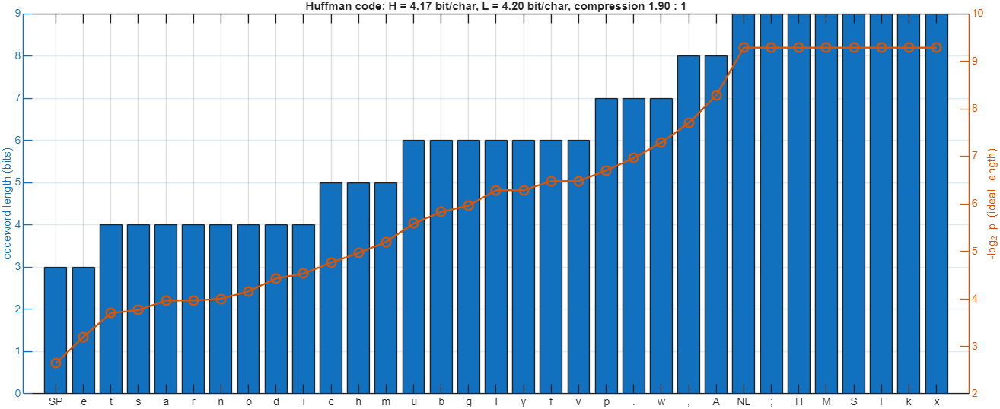
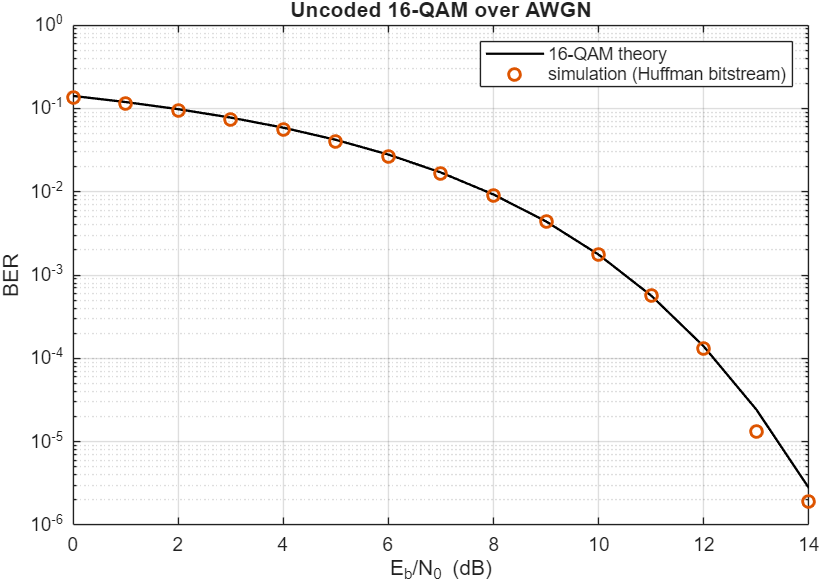
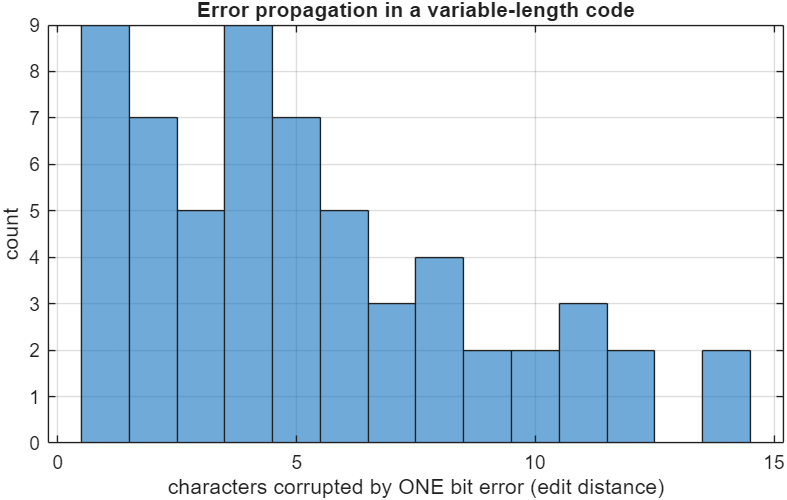
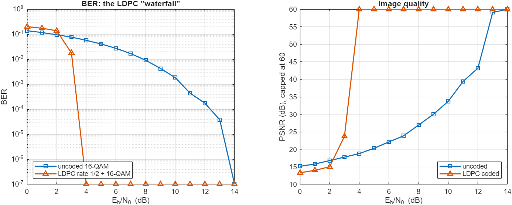
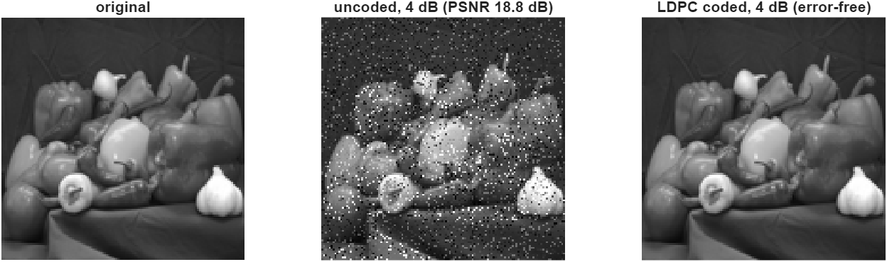
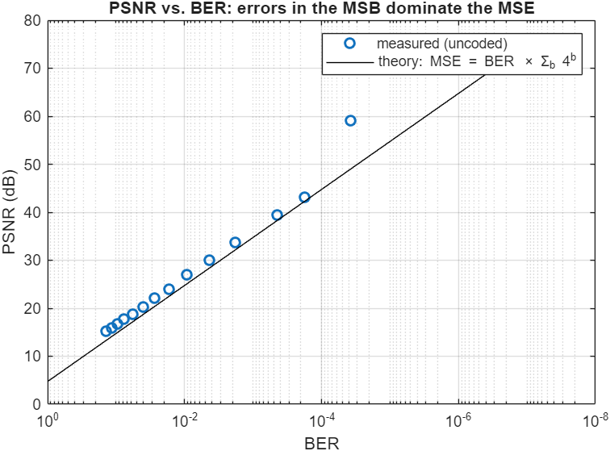
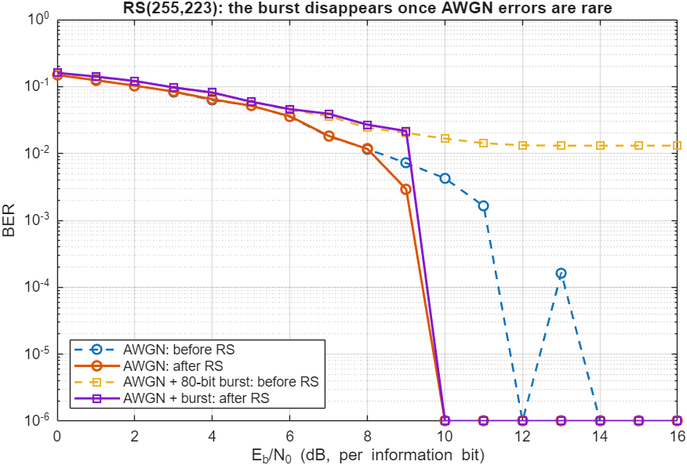
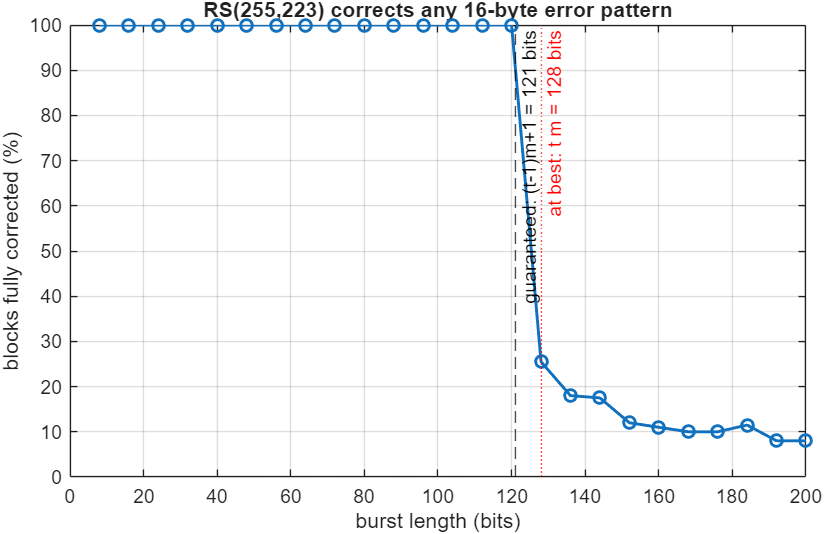

# Source and Channel Coding in MATLAB: Huffman, LDPC and Reed-Solomon (Digital Communications Lab, Experiment 2)

This repository contains end-to-end simulations of a digital link with **source coding** (Huffman) and **channel coding**:
- **LDPC** codes from DVB-S2, with soft-decision decoding
- **Reed-Solomon RS(255,223)**, the CCSDS standard code

The signals are carried on 16-QAM over an AWGN channel. A text message and an image are sent through the link, and the effects of bit errors, error propagation and burst errors are measured.

> **Course:** Digital Communications Lab, Amirkabir University of Technology, Spring 2026.

```matlab
>> run_all     % MATLAB + Communications Toolbox + Image Processing Toolbox -> ./results
```

## 2.1 Huffman coding + 16-QAM
The test message is a 624-character English paragraph ([`data/sample_text_short.txt`](data/sample_text_short.txt)) with 33 distinct characters.

| | bits per character |
|---|---:|
| ASCII | 8 |
| Fixed-length code for 33 symbols | 6 |
| **Huffman, average length L** | **4.20** (compression 1.90 : 1) |
| Entropy H (lower bound) | 4.17 (Huffman efficiency 99.4 %) |

The two most frequent characters (space and e) get 3-bit codewords, and the rarest get 9 bits. Each codeword length tracks −log₂ p. If every character were equally likely, there would be no redundancy to remove. Huffman would then assign only 5- and 6-bit codewords (average about 5.06 bits ≈ log₂ 33), which is essentially a fixed-length code.



The Huffman bitstream sent over uncoded 16-QAM follows the theoretical BER. At 12 dB the message arrives intact.

| BER | Error propagation |
|---|---|
|  |  |

**Error propagation.** The codewords have variable length, so a single flipped bit makes the decoder lose track of where codewords start. It then mis-parses the following characters until it happens to resynchronise. Flipping one bit at 60 different positions corrupted **5.2 characters on average (up to 14)**, measured as edit distance. This is why source-coder output is never fed straight to the modulator: a channel code has to remove the errors first.

## 2.2 Image transmission: uncoded vs. LDPC
The test image is a 128 × 128 grayscale picture (MATLAB's `peppers.png`), i.e. 131 kbit.

- **Uncoded:** 16-QAM directly.
- **Coded:** DVB-S2 LDPC (rate 1/2, n = 64 800), soft LLR demapping, 50 belief-propagation iterations.

E_b/N₀ is always counted per *information* bit, so the comparison is fair.



**The waterfall.** Below about 3 dB the LDPC decoder fails and is even slightly worse than uncoded, because each coded bit carries only half the energy. Within roughly 1 dB the BER then collapses from 10⁻¹ to zero errors. That sharp drop is the *waterfall region* of iterative decoding, near the code's threshold. At 4 dB the coded image is **error-free**, while the uncoded one still has BER = 6 × 10⁻² (PSNR 19 dB). Uncoded transmission needs about 14 dB for an error-free image, so the code gains about 10 dB.



**Why LDPC decoding is fast.** The parity-check matrix is sparse, so each check involves only a few bits. The cost of message passing therefore grows linearly with the block length.

**PSNR vs. BER.** The relationship is not linear. A flipped bit b changes a pixel by 2ᵇ, so with independent errors

$$\mathrm{MSE}=\mathrm{BER}\sum_{b=0}^{7}4^b,\qquad \mathrm{PSNR}\approx 10\log_{10}\frac{255^2}{21845\cdot\mathrm{BER}}$$

PSNR therefore rises by 10 dB per decade of BER, and **MSB errors dominate**: bit 7 alone accounts for 75 % of the MSE. The measured points sit 1–2 dB *above* this line. With Gray-mapped 16-QAM, the first two bits of each symbol (the sign bits) are more reliable, and the pixels were packed MSB-first, so the most important bits happened to get extra protection.



**64-QAM instead of 16-QAM** would carry 1.5× more bits per symbol (less bandwidth). It would need about 4 dB more E_b/N₀ for the same BER, so at a fixed E_b/N₀ the image would be noticeably worse.

## 2.3 Huffman + Reed-Solomon + 16-QAM, with burst errors
The 1185-character message ([`data/sample_text_long.txt`](data/sample_text_long.txt)) is Huffman-coded, packed into 8-bit symbols and protected with **RS(255,223) over GF(2⁸)**. Each block can correct up to **t = 16 erroneous bytes**. The scenario is run with AWGN only, and with AWGN plus a random **80-bit burst**.



- **Below about 10 dB** there are more than 16 byte errors per block, the decoder gives up, and the output is as bad as the input.
- **Above that, RS removes every error,** including the burst. At 12 dB the text is recovered with **0 character errors**.

**Why RS handles bursts well.** An 80-bit burst touches at most ⌈80/8⌉ + 1 = 11 bytes, which is well within t = 16. A binary code such as Hamming(7,4) corrects one bit per 7-bit word, so the same burst would defeat about 11 consecutive codewords. The noiseless burst test confirms the theory exactly. Any burst of up to (t − 1)·m + 1 = **121 bits** is always corrected. From 128 bits on, a burst only survives if it straddles two blocks.



**Source vs. channel coding.** Huffman removes redundancy (here −47 % bits), and RS adds 14 % structured redundancy back (rate 223/255). The net message is still smaller than ASCII, but it is now protected. Larger n − k means more correction but more overhead. If RS ever lets an error through, the Huffman decoder amplifies it, as shown in 2.1. Practical systems therefore interleave, or concatenate RS with an inner convolutional or LDPC code.

## Changes compared with the original lab submission
- **2.2 plots:** the BER legend was swapped (the uncoded curve was labelled "coded"). The three images were drawn with consecutive `imshow` calls into one figure, so only the last one survived.
- **Character errors:** these were counted position by position, which counts every character after a desynchronisation. They now use edit distance. Error propagation, the burst-length limit and the PSNR–BER theory are new analyses that answer the lab questions.
- **2.3 burst:** the burst was always injected at the same position. It is now random, and burst-only and AWGN-only runs are separated.
- **Inputs:** the original inputs were a copyrighted novel excerpt and a web photograph. They were replaced with two original paragraphs and an image that ships with MATLAB.

## Skills
Information theory (entropy, Huffman coding) · LDPC and Reed-Solomon codes · soft-decision (LLR) decoding · image-quality metrics · MATLAB Communications Toolbox

## Author
**Sepehr Ebrahimi**, B.Sc. Electrical Engineering, Amirkabir University of Technology (2026)
